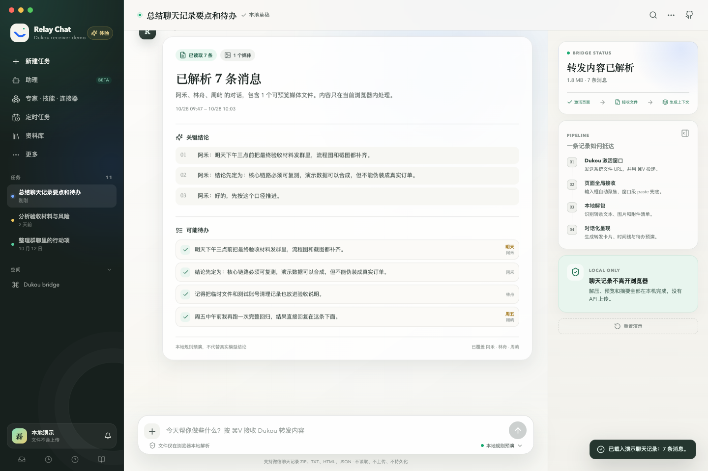
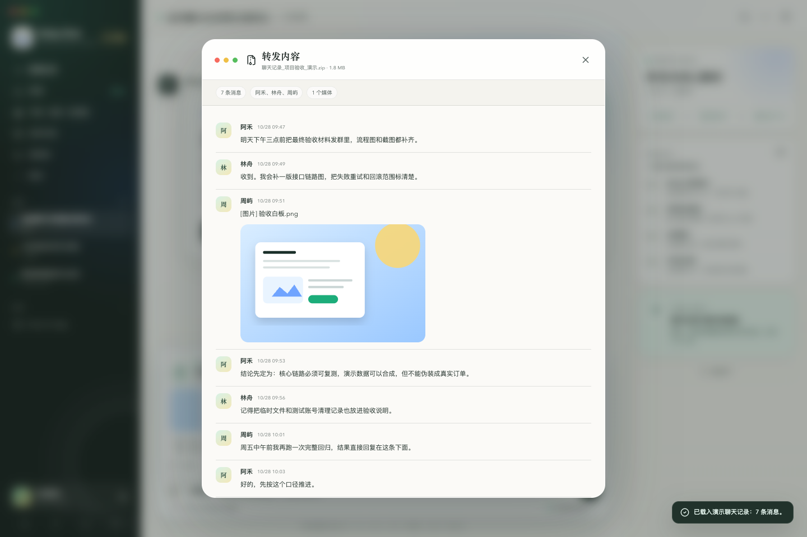

# Dukou → Relay Chat Desktop Demo

一个可下载安装的 macOS 桌面 Demo，用真实的系统文件剪贴板演示：

> 微信“合并转发” → Dukou 投递 ZIP → Relay Chat 接收 → 本地预览附件 → 生成对话上下文。

它复现了 WorkBuddy 类产品收到微信聊天记录后的关键体验。Today、豆包等应用若没有自己的微信分享接收能力，可以通过同样的“宿主应用接收并处理”方式获得可用的转发体验。

> 本项目是独立技术演示，与腾讯 WorkBuddy、微信、Dukou、Today 或豆包官方无关。界面和演示数据均为自建。



<details>
  <summary>查看“转发内容”完整时间线</summary>
  
</details>

## 下载与体验

前往 [GitHub Releases](https://github.com/leicheng42/dukou-workbuddy-bridge-demo/releases/latest) 下载 macOS 安装包：

- `Relay-Chat-Demo-*.dmg`：拖动 `Relay Chat Demo.app` 到“应用程序”；
- `Relay-Chat-Demo-*.zip`：解压后运行 App；
- `.sha256`：用于校验下载文件。

当前 Demo 没有 Apple Developer ID 签名和公证。首次打开时，请在 Finder 中右键 App，选择“打开”；如果系统仍阻止运行，可在“系统设置 → 隐私与安全性”中允许本次打开。

### 通过 Dukou 转发

1. 启动 Relay Chat Demo。
2. 在 Dukou 的“发送到自定义”中添加 `Relay Chat Demo.app`。
3. 使用 Dukou 的测试版本时，可以把这个 App 配置为直接显示。
4. 在微信中选择聊天记录，执行“合并转发”。
5. Dukou 激活 Relay Chat Demo，把聊天记录 ZIP 写入系统剪贴板并发送 `⌘V`。
6. App 收到文件后自动解压、展示附件和消息时间线。
7. 点击发送，查看本地规则生成的要点与待办预演。

如果 Dukou 无法自动粘贴，请在 Dukou 中重新确认辅助功能权限，或直接在 Relay Chat Demo 中按 `⌘V`。

### 浏览器体验

在线版本仍可直接体验：

<https://leicheng42.github.io/dukou-workbuddy-bridge-demo/>

网页版支持拖入文件、选择文件，以及浏览器允许暴露 `File` 时的 `⌘V`。

## 技术实现

整体链路如下：

```text
微信合并转发
    │
    ▼
Dukou 生成聊天记录 ZIP
    │  NSWorkspace 激活目标 App
    │  NSPasteboard 写入文件 URL
    │  CGEvent 发送 ⌘V
    ▼
Electron 主进程
    │  捕获 ⌘V，识别 text/uri-list
    │  读取本地文件并通过 IPC 投递
    ▼
沙箱渲染进程
    │  重建 File
    │  解压 ZIP、识别 UTF-8 / GB18030
    │  关联文本消息和媒体附件
    ▼
转发卡片 + 时间线 + 本地摘要
```

### 1. 目标应用先被激活

Dukou 不依赖微信提供开放接口。它把目标 App 作为“接收端”启动并置前，使目标窗口成为键盘事件接收者。Relay Chat Demo 在 Electron 中设置 `hiddenInset` 原生窗口，同时自动聚焦输入区。

### 2. 文件通过系统剪贴板传递

Dukou 把聊天记录 ZIP 的文件 URL 写入 macOS `NSPasteboard`，再模拟 `⌘V`。这比把 ZIP 路径当作普通文本粘贴更可靠，因为目标应用可以拿到真实文件内容。

Electron 的网页 `paste` 事件在部分 macOS 文件剪贴板场景下拿不到 `File`。因此桌面版增加了一个很小的系统桥接：

1. 主进程监听 `before-input-event`；
2. 检测 `text/uri-list`，从系统剪贴板取得 POSIX 文件路径；
3. 读取文件并通过受限 IPC 发送给渲染进程；
4. preload 只暴露 `onPasteFiles` 这一项能力；
5. 渲染进程把字节重新构造成标准 `File`，继续使用与网页版相同的解析器。

macOS 上读取文件 URL 的小工具是系统自带的 `/usr/bin/osascript`。它只读取剪贴板中的 `«class furl»` 路径，不执行剪贴板内容。

渲染进程保持 `sandbox: true`、`nodeIntegration: false` 和 `contextIsolation: true`。

### 3. 本地解析微信聊天记录

常见微信合并转发 ZIP 结构：

```text
聊天记录_20261028_104435.zip
├── 聊天记录.txt
└── 聊天记录内的图片、视频和文件/
```

解析器使用 `fflate` 在本地完成以下工作：

1. 解压 ZIP；
2. 查找聊天转录文件；
3. 兼容 UTF-8 和 GB18030；
4. 解析发送人、时间和正文；
5. 建立图片 Blob URL；
6. 根据文件名把媒体关联回对应消息；
7. 生成本地摘要和明确行动项。

附件卡片会优先展示图片缩略图、消息数量、附件数量和原始 ZIP 大小；完整预览则保留发送人、时间、文本、图片及附件顺序。

### 4. 对话上下文与隐私

界面层保留两份视图：

- 用户看到“转发内容”卡片与可展开的聊天时间线；
- 对话层使用同一份结构化消息生成摘要和待办。

没有后端、API Key、遥测或聊天内容上传。文件只在当前进程内解析，不写入 Local Storage；关闭页面或重置演示后，Blob URL 会被释放。

## 本地开发

要求：macOS、Node.js 22 或更新版本。

```bash
npm ci
npm run desktop:dev
```

常用命令：

```bash
npm test          # 单元测试
npm run build     # TypeScript 检查与网页构建
npm run desktop   # 构建后启动 Electron
npm run dist:mac  # 生成 universal DMG 和 ZIP
```

构建产物位于 `release/`。

## 打包与发布

桌面应用使用 Electron Builder 生成同时支持 Apple Silicon 和 Intel 的 universal 包。发布文件包括 DMG、ZIP 和 SHA-256 校验文件。

Dukou 本身使用 Swift 和自定义 App 组装脚本；本 Demo 复用它的产品分发思路，而不是 Swift 构建系统：应用有固定 Bundle ID、自定义图标、版本号、Release 产物和完整性校验。

当前仓库没有 Developer ID 证书，因此 CI 或本地发布包为未签名、未公证版本。生产分发应增加：

1. Apple Developer ID Application 签名；
2. Hardened Runtime；
3. Apple notarization；
4. 签名后的 DMG/ZIP 与更新校验。

## 测试

```bash
npm test
npm run build
python3 e2e/demo_test.py
```

端到端脚本覆盖：

- 示例转发、附件卡片和完整时间线；
- 真实 ZIP 上传与摘要生成；
- 移动端布局；
- 在线 Pages 版本。

桌面端另外验证了 macOS 文件剪贴板 → 原生 `⌘V` → Electron IPC → ZIP 解析 → 转发卡片的完整链路。

## 适用范围

这个 Demo 证明的是“任何能接收文件并处理内容的桌面宿主应用，都可以接入 Dukou”。它不会向 Today、豆包等第三方应用注入内容。若这些产品要原生获得同样体验，需要它们实现以下任一项：

- 支持从系统剪贴板接收文件；
- 提供自己的分享扩展；
- 提供受支持的本地导入或自动化接口。

## License

[MIT](LICENSE)

第三方组件与商标说明见 [THIRD-PARTY-NOTICES.md](THIRD-PARTY-NOTICES.md)。
